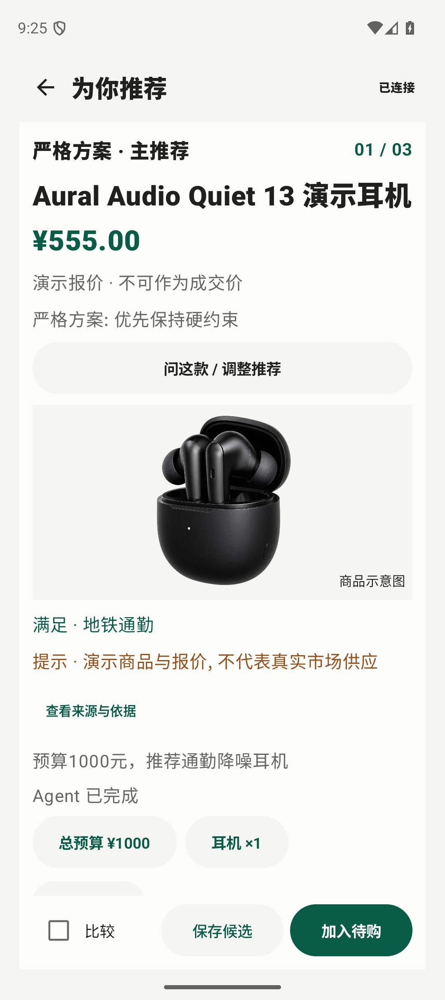
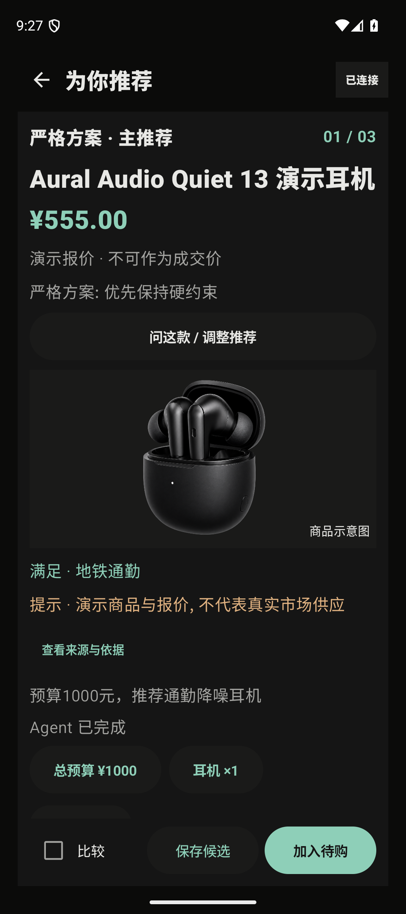
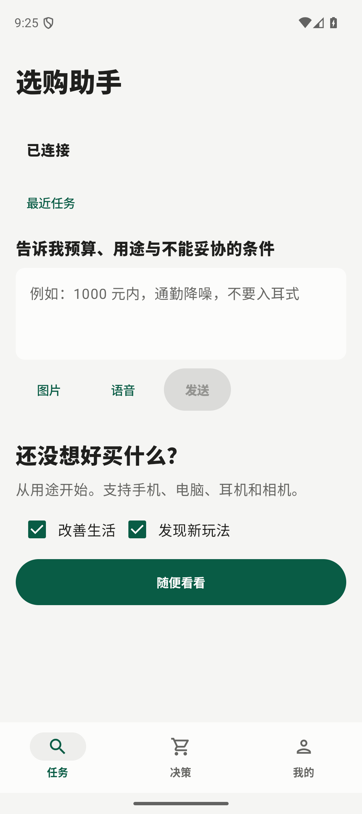
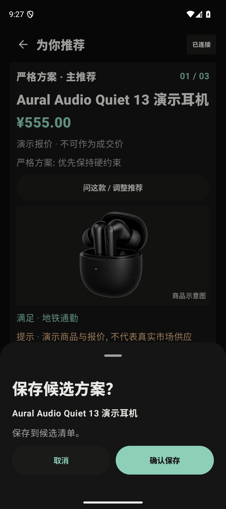
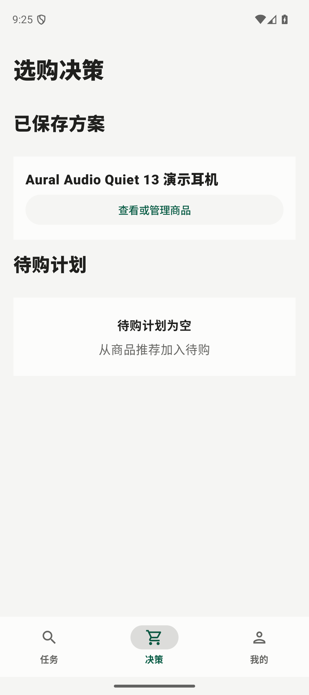
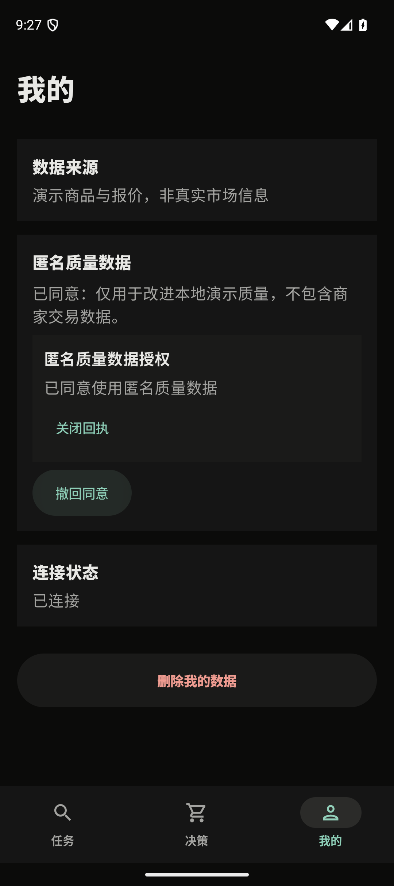
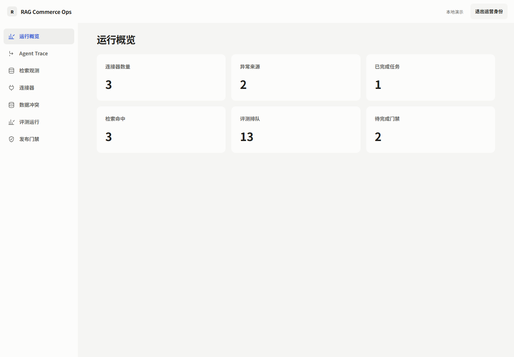
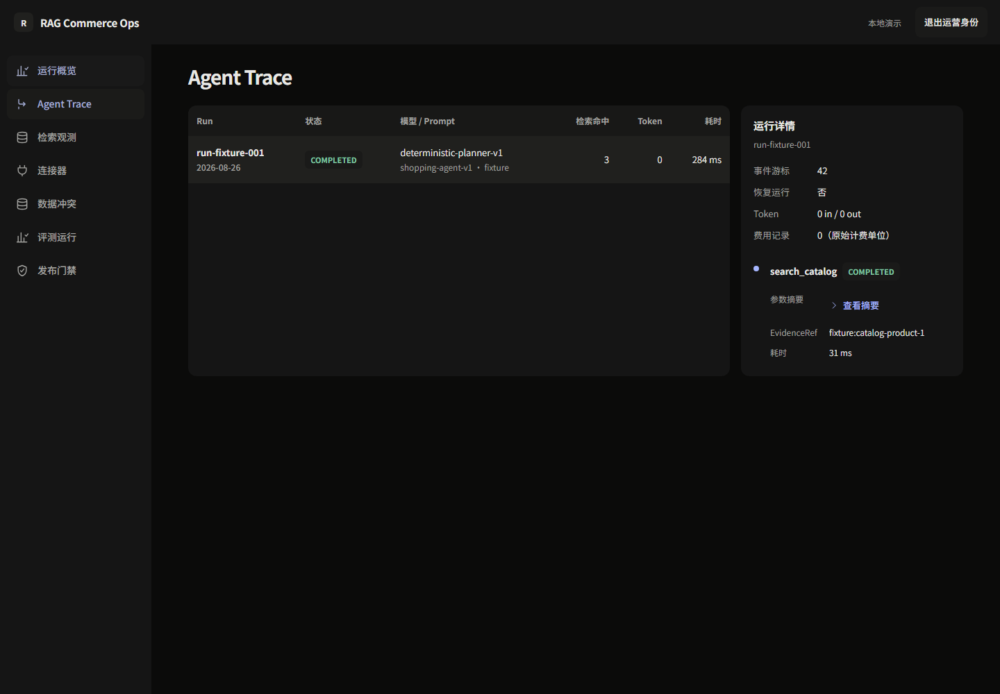

<p align="center">
  
</p>

<h1 align="center">RAG Commerce</h1>
<p align="center"><strong>把预算、用途与取舍，变成有依据的购买决定。</strong><br>面向 3C 选购的 Android 原生购物决策 Agent。</p>

<p align="center">
  <a href="https://github.com/JunyeFu/Rag-ecommerce-agent/actions/workflows/ci.yml"></a>
  <a href="LICENSE"></a>
  <a href="#技术选型"></a>
  <a href="#交付状态"></a>
</p>

<p align="center">
  <a href="#产品体验"><strong>查看新版界面</strong></a> · <a href="docs/evaluation/FRONTEND-PREVIEW-20261106.md">预览与验证说明</a>
</p>

<p align="center">
  <a href="#产品体验">产品体验</a> ·
  <a href="#实测证据">实测证据</a> ·
  <a href="#技术选型">技术选型</a> ·
  <a href="#本地体验">本地体验</a>
</p>

> **开发预览 · 2026-11-06。** 下列新版界面来自本地开发分支的实际运行；商品与报价均为演示数据。

## 产品体验

选购从“什么适合我”开始。RAG Commerce 将预算、用途和偏好组织成购买任务，让用户看清候选之间的差异，保存选择，并在确认后执行待购操作。

<p align="center">
  
  
</p>
<p align="center"><strong>信息看得清 · 选择始终在手边</strong><br>候选、理由与来源集中呈现，比较、保存和待购保持可达。</p>

同一套原生体验，适配浅暗主题、小屏与大字号。报价同时匹配商品和规格，到期后更新有效状态；操作结果在发生处给出回执，失败与结果未确认信息可保留、可关闭。

<details>
<summary><strong>展开完整选购流程与个人数据管理</strong></summary>

<p align="center">
  
  
</p>
<p align="center"><strong>说清需求 · 行动前确认对象</strong></p>
<p align="center">
  
  
</p>
<p align="center"><strong>保留选择，继续决策 · 管理自己的数据</strong></p>

</details>

截图拍摄于 2026-11-06，来自 API 35 模拟器与本地 fake-provider HTTP/SSE 流程。对应代码仍在本地开发分支，截图不表示 main 已包含该版本；当前候选 APK / 视频签收见[预览说明](docs/evaluation/FRONTEND-PREVIEW-20261106.md)。

### 从表达需求到继续决策

| 用户要完成的事 | 产品如何承接 |
| --- | --- |
| **说清需求** | 输入用途、预算与硬约束；支持图片理解后的确认、澄清和条件修改 |
| **理解取舍** | 查看候选依据、规格差异和报价时效；缺失信息保留为未知 |
| **保留选择** | 比较、保存候选、组织购买任务，通过快照与游标继续处理 |
| **确认行动** | 审批绑定具体操作和参数；拒绝不写入，确认后按幂等回执执行 |

适合评估 **有预算和用途约束的 3C 导购**，以及商家或平台的购买前决策组件。商业价值定位于需求组织与证据推荐；消费者留存、转化率、收入和客户采用情况尚未测量。

<details>
<summary><strong>查看新版 Ops 运营台</strong></summary>





运营台将概览、执行详情与诊断信息分层呈现，保留任务状态、证据和发布门禁。2026-11-06 本地 fixture 截图中的 284 ms、Token 与统计值均为演示内容，不计入下文 Agent 性能实测。

</details>

<details>
<summary><strong>查看历史演示视频</strong></summary>

[观看 87 秒历史演示](docs/media/rag-commerce-v3-demo.mp4)。视频保留旧版界面，不代表本次新版前端；拍摄与构建信息见[素材清单](docs/media/manifest.json)。

</details>

### 新版前端的本地验证

| 已验证内容 · 2026-11-06 | 结果与范围 |
| --- | --- |
| **Android 行为与状态** | **68 项单元 + 76 项原生 fixture 回归通过**；报价匹配与到期、确认、系统返回、操作回执均有覆盖 |
| **布局与可访问操作** | 原生回归中包含 **12 组**推荐布局：两档屏幕 × 三档字号 × 浅暗主题，正文滚动与固定操作可达 |
| **本地端到端体验** | 同一实际 MainActivity HTTP/Agent/SSE 流程浅暗各通过一次；模型为 **fake**，数据为演示目录 |
| **Ops 呈现与交互** | 设计规范批次 **8 项 E2E 通过**；随后聚焦反馈用例另测通过，非新增业务覆盖 |

以上是开发分支的本地验证，未新增真实模型跑分或物理设备验收。[验证范围与结果](docs/evaluation/FRONTEND-PREVIEW-20261106.md) · [机器可读摘要](docs/evidence/v3/frontend-preview-20261106.json)

## 实测证据

以下保留既有报告的原始日期与口径。真实模型、检索组件和平台容量分别统计，新版 UI 的本地验证单独列在上方。

<table width="100%">
<tr>
<td width="33%" align="center"><h3>9 / 10</h3><strong>真实模型场景完成</strong><br><sub>MiMo 黄金集首轮 · 10 场景<br>2026-10-09</sub></td>
<td width="33%" align="center"><h3>182 ms</h3><strong>平台接单 p95</strong><br><sub>fake 模型 / 双 Worker / 本地 BGE<br>2026-10-24</sub></td>
<td width="33%" align="center"><h3>1,785 ms</h3><strong>Android 冷启动 p95</strong><br><sub>QA debug APK / API 35 模拟器<br>2026-10-13</sub></td>
</tr>
</table>

**接单耗时不等于推荐完成耗时。** 真实模型首轮场景耗时中位数为 **38.827 s**，p95 为 **191.270 s**，含工具与场景后置检查。G07 首轮失败，后续复测单独列示；10 条样本不能外推真实用户成功率。

<details>
<summary><strong>查看完整指标、样本条件与原始证据</strong></summary>

| 测量层级 / 日期 | 样本与条件 | 结果 | 证据 |
|---|---|---|---|
| **真实 MiMo 黄金集首轮 · 10-09** | G01–G10；真实 API / PostgreSQL / Worker；演示数据 | **9/10** 完整通过；解析与场景级 Schema 各 **10/10**；推荐证据完整的运行 **10/10** | [逐场景与复测](docs/evaluation/AGENT-PERFORMANCE.md#真实-mimo持久化黄金集首轮) |
| **真实模型场景耗时与用量 · 10-09** | 同一首轮 10 场景，含工具与场景后置检查，失败保留 | 中位数 **38.827 s**；p95 **191.270 s**；**86,158 Token / 22 次付费调用记录**；供应商未返回金额 | [统计与口径](docs/evaluation/AGENT-PERFORMANCE.md) |
| **检索消融 · 10-13** | 60 SKU；120 查询按 40 / 80 划分，验收含 64 个有匹配查询 | Recall@10 三路均 **1.000**；NDCG@10：BM25 **1.00000**、BGE **0.98102**、RRF **0.99348**；融合无增益 | [冻结报告](docs/evidence/v3/final-N07-retrieval-20261013.json) |
| **本地平台容量 · 10-24** | 十批 × 30，共 300；真实 PostgreSQL、双 Worker、本地 BGE、**fake 模型** | **300/300** 完成，**10/10** 批次通过；接单 p95 **182.079 ms**；202 后首状态 p95 **111.482 ms**；提交至 Worker 开始 p95 **828.236 ms** | [完整验收与负结果](docs/evidence/v3/final-F60-review-20261024.json) |
| **Worker 进程恢复 · 10-13** | 真实 PostgreSQL + 子进程故障注入 + fake | 自然 300 s 租约下 **304.438 s** 恢复；写入、回执与终态不重复 | [故障注入](docs/evidence/v3/final-N07-worker-process-recovery-02-20261013.json) |
| **Android 场景覆盖 · 截至 10-13** | 具名尝试与修复复测；模拟器，实际 API / MiMo 或零新增调用的 UI 收尾 | **8/10 项已覆盖**；A02 有效人声、A09 完整外跳待完成；不作为首轮通过率 | [场景矩阵](docs/evaluation/AGENT-PERFORMANCE.md#原生-android-场景覆盖) |
| **Android 冷启动 · 10-13** | 同一已安装 QA debug APK；准备前后各 30 次，API 35 模拟器 | p95 **3,179 → 1,785 ms**；后组最大 2,630 ms；非 release / 真机性能 | [同 APK 复审](docs/evidence/v3/final-NFR07-verified-dex-review-20261013.json) |
| **TalkBack 限定验收 · 10-24** | 字号 1.0 / 2.0；原生模拟器 + fake + 内存 API | **8/8** 路径通过；不替代全产品无障碍与真机验收 | [范围与历史失败](docs/evidence/v3/android-talkback-20261024.json) |

检索负结果同样保留：该冻结小目录上 **BM25 的 NDCG@10 优于 RRF**，混合检索没有质量增益证据。历史容量也保留未通过批次，未回填为成功；详见[完整性能报告](docs/evaluation/AGENT-PERFORMANCE.md)。

统计覆盖 14 组历史黄金集报告、持久化首轮场景、复测、图片、原生端、检索、容量与启动数据。[机器可读结果](docs/evaluation/agent-metrics-20261105.json)可离线复算：

```powershell
python scripts/summarize_agent_metrics.py --check
```

构造 reference 的 1,000 条确定性结果不计入真实 Agent 性能。多模型对照、真实模型并发容量、首张推荐时延、实际每任务金额和消费者转化率暂无测量结果。

</details>

**工程验证 · 2026-11-06：** [已合并修复 #28](https://github.com/JunyeFu/Rag-ecommerce-agent/pull/28)的[完整 CI 五项通过](https://github.com/JunyeFu/Rag-ecommerce-agent/actions/runs/42065228011)：Python **300 通过 / 7 跳过**，隔离真实 TLS **另跑 6 通过**；Web、Android 与 Compose 通过。[修复与验证记录](docs/evaluation/AGENT-REMEDIATION-CLOSE-20261106.md)保留分组口径、历史失败和剩余门禁。

## 技术选型

架构围绕三个判断展开：**原生任务连续性、商品事实可核验、工具操作受授权。** 采用单 Agent 规划与确定性执行器，避免把事实和写入权限交给模型文本。

| 组成 | 采用它的理由与代价 |
| --- | --- |
| **Kotlin / Compose / Room** | 原生生命周期承接图库、录音、无障碍与恢复；承担 Android 专用 UI 的维护成本 |
| **Python / FastAPI / LangGraph** | 规划、工具、ONNX 与评测共享生态；承担 CPU 阻塞、状态契约和跨语言维护成本 |
| **PostgreSQL / Worker / SSE** | 任务与 Job 同事务落库，事件可回放；队列、租约及故障恢复由项目维护 |
| **BM25 / 本地 BGE / Qdrant / RRF** | 关键词与语义检索接到商品证据；增加模型和向量服务，当前小目录实测 BM25 排序更好 |
| **React / TypeScript / Vite** | Ops 类型契约与静态交付直接；需要公开内容与 SEO 时再评估服务端渲染 |

<details>
<summary><strong>查看备选技术栈、选择条件与系统实现</strong></summary>

| 层次 / 实际采用 | 选择理由 | 已承担的代价 | 其他技术栈更合适的条件 |
|---|---|---|---|
| **Kotlin 2.0 / Compose / Room** | 在原生生命周期内处理图库、AudioRecord、TalkBack 与任务恢复 | Android 专用 UI，另做 iOS 需要投入 | Flutter / React Native：多端复用优先，且具备相应团队能力 |
| **Python 3.12 / FastAPI / Pydantic** | Agent、ONNX 推理和评测共用语言，OpenAPI 连接三端类型 | 需管理 CPU 阻塞、GC 与内存；与客户端跨语言维护 | TypeScript：统一 Web/API；Go / Java：以既有服务体系与团队积累为主 |
| **LangGraph + 单 Agent + 确定性执行器** | 控制流清楚，规划与事实、授权、写入分工明确 | 模型等待仍长，状态与工具契约需要维护 | 普通函数流适合固定短流程；任务确有可分工收益时再评估多 Agent |
| **PostgreSQL 16 + 独立 Worker + SSE** | Turn / Job 同事务落库，减少 Broker 双写；事件支持重放 | 租约与队列逻辑自行维护，300 s 租约影响故障恢复 | Celery + Broker：复杂路由 / 多队列；WebSocket：持续双向实时交互 |
| **BM25 + 本地 BGE / ONNX + Qdrant + RRF** | 关键词、语义、过滤与证据形成可复跑链路 | 多一个向量服务和本地模型；**当前实测 BM25 排序更好** | BM25-only：窄目录精确检索；pgvector：希望合并关系与向量存储 |
| **React 19 / TypeScript / Vite / TanStack Query** | Ops 连接既有 API，静态构建可交付 | 不提供完整的公开内容与 SEO 方案 | Next.js 等框架：出现公开内容、路由与渲染需求时按需选择 |

以上是基于当前实现的工程比较，备选技术栈未做等条件跑分；完整版本、源码入口和官方参考见[技术选型复盘](docs/architecture/TECH-STACK-DECISIONS.md)。

```text
Android：需求 → 澄清 / 图片确认 → 推荐 → 比较 / 保存 / 审批
    │ POST Turn / 用户决定                  ▲ SSE / ThreadSnapshot
    ▼                                     │
FastAPI → PostgreSQL：Turn + Job → 独立 Worker
    → LangGraph 单 Agent：guard → plan → tools → respond
    → 确定性执行器：11 个注册工具、授权、事实守卫、幂等与持久化

60 个自有 3C SKU → 结构化过滤 + BM25 / 本地 BGE → RRF → EvidenceRef
MinIO：图片 / 音频对象                    Ops Web：Trace / 检索 / 门禁
```

- **事实边界：** 价格来自带来源、采集/失效时间和验证级别的 `OfferQuote`；`DISCOVERY_ONLY` 不参加最低价排序。模型负责规划和多模态理解，公开阶段文本由运行时生成。
- **执行边界：** 11 个注册工具；审批绑定调用及参数，执行器核验归属和授权。支付、订单、退款与履约不在首版范围。
- **基础设施：** Docker Compose、MinIO；OpenAPI 生成类型，OpenTelemetry 观测。Redis 在配置中，当前主链未调用；PostgreSQL 镜像含 pgvector，实际向量检索使用 Qdrant。

[C4 设计](docs/architecture/V3-C4.md) · [Agent 时序](docs/architecture/V3-AGENT-SEQUENCE.md)

</details>

## 交付状态

| 评估方向 | 当前可审阅内容 | 下一阶段条件 |
| --- | --- | --- |
| **工程与产品评估** | 公开源码、原生体验素材、历史实测、身份/审批/恢复及 CI 证据 | 开发分支源码同步、当前候选同版 APK / 视频、完整人声与浏览器外跳、独立复审 |
| **授权导购接入** | 类型化报价、来源/时效、用户确认和受控 HTTPS 传输 | 联盟授权、LIVE 报价/深链、更新条件与正式部署 |
| **消费者或商家服务** | 可运行的购买前决策机制与演示 | 真实用户、物理设备、安全/法务和业务人审、容量与运维验收 |

外部验收按用户指令暂停，商业发布维持 **NO_GO**。不承诺全网最低价、实时库存或生产 SLA；[交付记录](docs/release/local-portfolio.json)及[缺陷记录](docs/defects/V3-FINAL-CLOSEOUT.md)保留未完成项，历史 [v0.3.0](https://github.com/JunyeFu/Rag-ecommerce-agent/releases/tag/v0.3.0) 不代表当前候选发布资格。

## 本地体验

固定工具链：Python **3.12.11** · uv **0.11.13** · Node **24.15.0** · npm **12.0.1** · Java **21**；需要 Docker Desktop 与 Android SDK。见[完整配置](toolchain.versions.json)。

```powershell
./scripts/bootstrap.ps1 -Quick
./scripts/start_v3_demo.ps1 -ProviderMode fake -RetrievalMode local -DatabaseName ragcommerce_candidate
./apps/android/gradlew.bat -p apps/android :app:assembleDebug -PapiUrl=http://10.0.2.2:20881
```

API `127.0.0.1:20881` · Ops `127.0.0.1:24174` · Android 模拟器 `10.0.2.2:20881`。端口需空闲；停止使用 `./scripts/stop_v3_demo.ps1`，仅处理启动记录拥有的资源，保留数据卷。

启动明确选择 fake 模型与本地 BGE，首次准备可能下载固定依赖和模型；运营凭据由[管理员命令](scripts/manage_ops_identity.py)签发。真实模型使用独立授权与预算，不静默回退或自动重试。

---

[文档中心](docs/README.md) · [技术决策](docs/architecture/TECH-STACK-DECISIONS.md) · [评测方法](docs/evaluation/methodology.md) · [任务与证据](docs/task-packages/manifest.json) · [贡献说明](CONTRIBUTING.md) · [MIT 许可](LICENSE)

<sub>MIT 覆盖项目自有源码、60 SKU 与项目生成美术资产；第三方依赖按各自许可使用。MinIO 固定版本为 AGPL-3.0-only，商业交付需结合实际部署确定第三方许可范围。</sub>

<p align="center"><sub>Native Android · Evidence-backed recommendations · Explicit approval · Durable recovery</sub></p>
