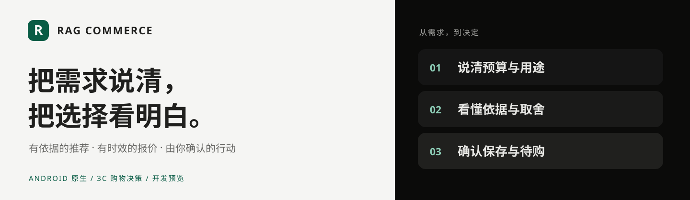
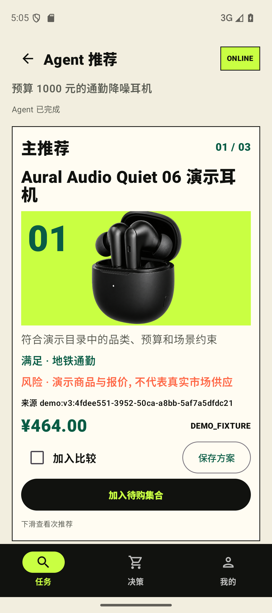
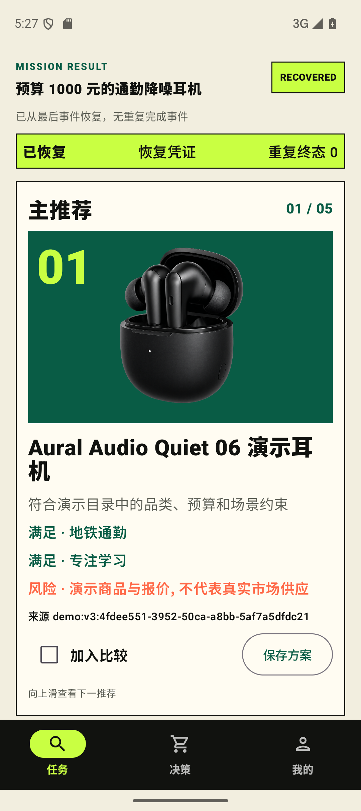
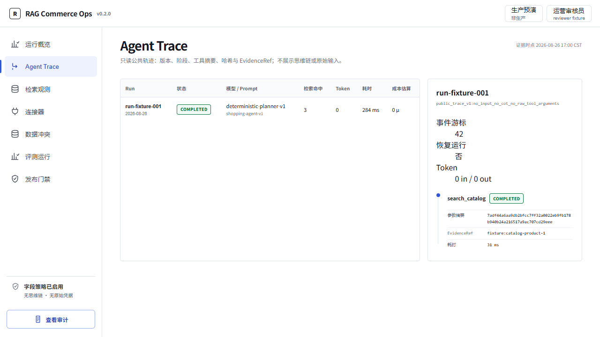
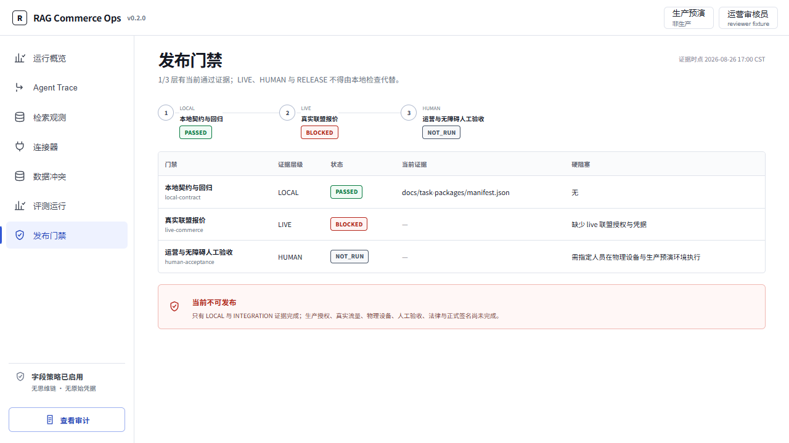

<p align="center">
  
</p>

<h1 align="center">RAG Commerce · 购物决策 Agent</h1>
<p align="center"><strong>说出需求，看懂取舍，由你决定。</strong><br>Android 原生体验，把需求澄清、证据推荐与购买前决策连成一条线。</p>
<p align="center">
  <a href="#产品画廊">查看产品画面</a> ·
  <a href="docs/media/rag-commerce-v3-demo.mp4">观看 87 秒历史演示</a> ·
  <a href="#三条快速启动命令">本地体验</a> ·
  <a href="docs/architecture/V3-C4.md">架构设计</a>
</p>

> **研发展示版 · 非商业上线服务。** 当前候选仍为 **HOLD**，未公开发布；商品与报价为演示数据。下方历史运行截图用于展示交互与视觉设计，不代表当前源码已完成验收。

## 不止给你一张商品列表

| 从需求开始 | 把推荐讲清楚 | 把决定交给你 |
| :--- | :--- | :--- |
| 描述预算、用途与偏好，逐步澄清购买约束。 | 查看推荐理由、约束匹配与报价来源，再比较候选。 | 保存方案或确认加入待购，让下一步建立在明确授权上。 |

## 产品画廊

### 01 / Android · 从推荐到决策

<table>
<tr>
<td width="50%" align="center"></td>
<td width="50%" align="center"></td>
</tr>
<tr>
<td><strong>推荐有依据</strong><br>商品、场景匹配、来源与操作集中在同一张卡片中，帮助用户理解推荐。</td>
<td><strong>任务有连续性</strong><br>恢复界面呈现任务状态；恢复能力的具体通过范围见下方分层验收记录。</td>
</tr>
</table>

### 02 / Ops · 看得见的执行过程



**运行轨迹** — 用工具状态、检索命中和证据引用解释执行过程，方便开发与运营定位问题。

<details>
<summary><strong>展开查看发布门禁界面</strong></summary>



</details>

以上四张画面来自仓库已有的[历史运行素材](docs/media/manifest.json)，包含 fixture 数据；[历史视频](docs/media/rag-commerce-v3-demo.mp4)可下载播放。当前候选视频与最终原生验收尚未签收。

## 为可信决策而设计

- **事实来自证据。** 报价来自 `OfferQuote`，携带来源、采集时间、失效时间与验证级别；发现型候选不参与最低价排序。
- **行动需要授权。** 模型负责规划与解释，执行器负责权限、审批与持久化；首版不包含支付、订单、退款和履约。
- **体验连接工程。** Android 原生前端、持久化任务与增量事件衔接；Ops 提供运行与检索观测入口。

> A native Android shopping agent for evidence-backed recommendations and explicit user decisions. Built with Kotlin / Compose, FastAPI, PostgreSQL and hybrid retrieval.

## 三分钟看懂

用户不是在浏览一版缩小的商城首页，而是在执行一条 Shopping Mission。单管理 Agent 只负责结构化计划、澄清和解释；执行器负责工具 Schema、权限、幂等、预算与审计。商品与商业事实只能来自工具证据，演示报价永久标记为 `DEMO_FIXTURE`。

```text
Android → API 写入 Turn/Job → Worker 领取
        → Agent + 10 个类型化工具 → PostgreSQL 事件日志
        → SSE / ThreadSnapshot → Android + Ops

检索：BM25 + 向量 + 结构化过滤 → RRF 融合 → EvidenceRef
```

核心技术栈：Kotlin、Jetpack Compose、Room、FastAPI、LangGraph、PostgreSQL、Qdrant、MinIO、Redis、React、TypeScript、OpenAPI、OpenTelemetry。

## 历史版本证据

<details>
<summary><strong>展开 v0.3.0 的评测与发布记录</strong></summary>

以下结论属于历史版本，不代表本地开发候选完成验收。

| 层级 | 当前结果 | 含义 |
|---|---:|---|
| 60 SKU / 10 黄金场景 fixture | Recall@10 `1.00`、NDCG@10 `1.00` | 项目自有数据上的确定性开发基线，不是真实模型结论 |
| MiMo `mimo-v2.5` 真实评测 | `PASS — 10/10 parseable` | Schema 100%、流程 9/10、证据 100%、零越权、零商业事实伪造；平均场景延迟 65.8 秒 |
| 作品集发布 | `GO` | [PR #26](https://github.com/JunyeFu/Rag-ecommerce-agent/pull/26) 四项 CI 全绿，已合入 `main` 并发布 [v0.3.0](https://github.com/JunyeFu/Rag-ecommerce-agent/releases/tag/v0.3.0) |
| 商业发布 | `NO_GO` | 缺联盟授权、LIVE 报价、物理设备、双人盲评与生产安全/法律门禁 |

真实评测与 fixture 使用不同报告；Provider 失败不会静默切换 fake。通过报告见 [MiMo run-009](docs/evidence/v3/mimo-v2.5-real-evaluation-run-009.json)，详细边界见 [发布矩阵](docs/release/release-gate-matrix.json) 和 [求职收口任务包](docs/task-packages/packages/V3-PORTFOLIO-CLOSE-01/TASK.md)。

</details>

## 三条快速启动命令

以下命令对应公开 main 版本。

要求：Python 3.12.11、uv 0.11.13、Node 24.15.0、npm 12.0.1、Java 21、Docker 与 Android SDK。

```powershell
git clone https://github.com/JunyeFu/Rag-ecommerce-agent.git; Set-Location Rag-ecommerce-agent
./scripts/bootstrap.ps1 -Quick
./scripts/start_v3_demo.ps1
```

启动后，Ops 位于 `http://127.0.0.1:24174`；Android debug APK 固定访问模拟器宿主 `http://10.0.2.2:8080/`，不提供离线 fixture 回退。

## Agent 闭环

1. Android 创建购买 Mission，提取预算、用途、硬约束、排除项和待澄清字段。
2. Agent 调用商品检索、事实、报价、比较、清单、待购、重新询价和链接解析等十个冻结工具。
3. 结构化商品卡展示匹配理由、不满足项、风险、EvidenceRef 与报价等级；主、次、再次推荐纵向浏览。
4. 可逆写入和外部跳转必须审批；重复请求由幂等键约束。
5. Worker 重启或 SSE 断线后从持久化游标恢复，不重复终态事件。


## 工程质量与设计取舍

- 单 Agent 而非多 Agent：边界更清晰，Trace 和失败归因更可讲。
- PostgreSQL durable job 而非 Kafka：满足单人作品集的恢复与并发目标，避免无证据的基础设施膨胀。
- 只保留必要防线：HTTPS/过期链接、审批与幂等、SSE 恢复、Worker 租约、媒体补偿和商业事实约束。
- 删除旧商城 UI、静态 Ops 数据、未接入传输层的通用韧性模块和许可待定旧 seed；窄范围 minimality CI 防止回归。
- 公共 API 契约版本独立为 `0.2.0`，产品版本为 `0.3.0`。


## 面试讲解入口

- [C4 架构](docs/architecture/V3-C4.md)
- [Agent 时序](docs/architecture/V3-AGENT-SEQUENCE.md)
- [五分钟演示脚本](docs/demo/V3-FIVE-MINUTE-DEMO.md)
- [二十分钟系统设计讲解](docs/demo/V3-SYSTEM-DESIGN-INTERVIEW.md)
- [检索与评测方法](docs/evaluation/methodology.md)
- [任务包与证据清单](docs/task-packages/manifest.json)

## License

MIT 覆盖本项目自有源码、60 SKU 演示数据和项目生成美术资产；第三方依赖继续遵循各自许可证。所有商品、商家与报价均为演示 fixture，不代表真实市场供应。

## 本地目录约定

- 本仓库（v2）是 Rag-ecommerce 项目在 `D:\Agent` 下的唯一入口；旧迭代检出（指向 fujunye-company 远端、落后 18 提交）已整体归档至 `_archive/rag-v1-fujunye-company/`。`_archive/` 经 `.git/info/exclude` 本地排除，不入库。
- 并行任务 worktree 统一放 `_worktrees/`，合并后即删。
