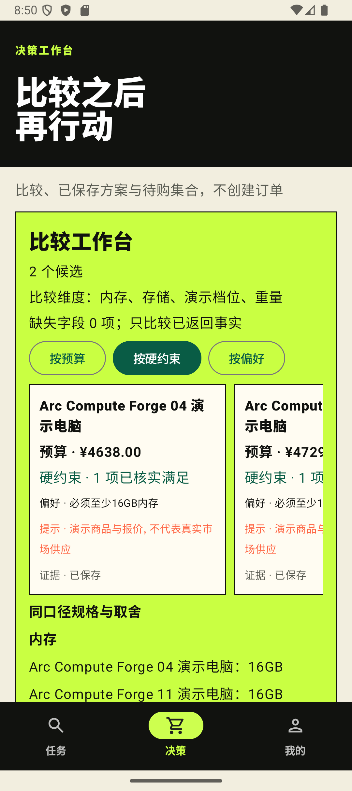

<p align="center">
  
</p>

<h1 align="center">RAG Commerce · 购物决策 Agent</h1>
<p align="center"><strong>说出需求，看懂取舍，由你决定。</strong><br>面向 3C 选购的 Android 原生助手，连接需求澄清、证据推荐与购买前决策。</p>
<p align="center">
  <a href="#产品画廊">产品画廊</a> ·
  <a href="#技术栈与选型">技术选型</a> ·
  <a href="#agent-实测指标">实测指标</a> ·
  <a href="#本地体验">本地体验</a> ·
  <a href="docs/media/rag-commerce-v3-demo.mp4">87 秒历史演示</a>
</p>

> **研发展示版｜当前候选 HOLD｜商业发布 NO_GO。** 商品与报价为项目自有演示数据；源码已公开，当前候选尚未正式发布。本文于 **2026-11-05** 核对技术栈并离线汇总已有实测，报告日期与条件分别标注。

## 产品定位与商业价值

用户的问题往往是“这个预算下，什么适合我的用途”，随后才是“哪一件值得买”。RAG Commerce 把预算、硬约束和偏好变成可持续的购买任务：先澄清，再给出带商品事实、报价来源和取舍理由的候选，最后由用户比较、保存或确认加入待购。

| 购买中的问题 | 已实现的产品机制 | 面向商业应用的价值 |
|---|---|---|
| 需求分散，搜索条件难以一次说清 | 文字需求、用途探索、约束修改；图片理解后由用户确认 | 把自然语言需求衔接到结构化商品检索 |
| 推荐理由与价格依据分离 | EvidenceRef、类型化 OfferQuote、报价时效、候选比较 | 让推荐与可追溯的商品信息一起呈现 |
| 对话结束后，选择容易丢失 | Mission、保存候选、待购、快照与进程恢复 | 让购买前决策可以继续处理 |
| 模型建议容易被误当成执行授权 | 明确审批、固定调用参数、幂等回执、Ops Trace | 为接入商家或平台工具提供受控执行基础 |

**适合评估的方向：** 有预算与用途约束的 3C 导购、商家或平台的购买前决策组件。真实消费者留存、转化率、收入与客户采用情况尚未测量，当前商业价值是产品定位与可验证机制，不包含已获得商业回报的声明。

## 产品画廊

### Android · 推荐、比较与任务连续性

<table>
<tr>
<td width="50%" align="center"></td>
<td width="50%" align="center"></td>
</tr>
<tr>
<td><strong>推荐有依据</strong><br>商品、场景匹配、报价来源与操作放在同一张卡片中。</td>
<td><strong>选择看得懂</strong><br>按约束与偏好比较候选，保存方案并继续处理购买任务。</td>
</tr>
</table>

### Ops · 执行过程与证据


工具状态、检索命中与证据引用用于定位执行问题，门禁界面单独呈现验收层级。

<details>
<summary>查看任务恢复与发布门禁画面</summary>


</details>

画面为仓库已有运行素材，含演示商品与报价；比较页来自 2026-10-21，其他素材见[历史素材清单](docs/media/manifest.json)。[87 秒视频](docs/media/rag-commerce-v3-demo.mp4)属于历史演示，当前候选的同版 APK / 媒体签收仍待完成。

## Agent 架构与事实边界

```text
Android：需求 → 澄清 / 图片确认 → 推荐 → 比较 / 保存 / 审批
    │ POST Turn / 用户决定                  ▲ SSE / ThreadSnapshot
    ▼                                     │
FastAPI → PostgreSQL：Turn + Job → 独立 Worker
    → LangGraph 单 Agent：guard → plan → tools → respond
    → 确定性执行器：11 个注册工具、授权、事实守卫、幂等与持久化

60 个自有 3C SKU → 结构化过滤 + BM25 / 本地 BGE → RRF → EvidenceRef
MinIO：图片 / 音频对象                    Ops Web：Trace / 检索 / 门禁
```

- **事实有来源：** 价格来自 `OfferQuote`，附来源、采集时间、失效时间和验证级别；`DISCOVERY_ONLY` 不参与最低价排序。LLM 负责规划与解释，不生成价格、库存、销量、物流或商家身份事实。
- **行动有边界：** 审批绑定具体调用和参数，执行器核验归属与授权；支付、订单、退款及履约不在首版工具注册表中。
- **任务可继续：** PostgreSQL 保存任务、事件和回执，Worker 租约处理进程中断，Android 通过持久游标与快照恢复。

[现有 C4 设计](docs/architecture/V3-C4.md) · [Agent 时序设计](docs/architecture/V3-AGENT-SEQUENCE.md) · [当前实现与选型复盘](docs/architecture/TECH-STACK-DECISIONS.md)

## 技术栈与选型

选型优先服务于 **Android 连续体验、商业事实可核验、操作受授权和本地可复现**。下表是按当前实现补做的工程比较；备选技术栈未做等条件跑分。

| 层次 / 实际采用 | 选择理由 | 已承担的代价 | 其他技术栈更合适的条件 |
|---|---|---|---|
| **Kotlin 2.0 / Compose / Room** | 在原生生命周期内处理图库、AudioRecord、TalkBack 与任务恢复 | Android 专用 UI，另做 iOS 需要投入 | Flutter / React Native：多端复用优先，且具备相应团队能力 |
| **Python 3.12 / FastAPI / Pydantic** | Agent、ONNX 推理和评测共用语言，OpenAPI 连接三端类型 | 需管理 CPU 阻塞、GC 与内存；与客户端跨语言维护 | TypeScript：统一 Web/API；Go / Java：以既有服务体系与团队积累为主 |
| **LangGraph + 单 Agent + 确定性执行器** | 控制流清楚，规划与事实、授权、写入分工明确 | 模型等待仍长，状态与工具契约需要维护 | 普通函数流适合固定短流程；任务确有可分工收益时再评估多 Agent |
| **PostgreSQL 16 + 独立 Worker + SSE** | Turn / Job 同事务落库，减少 Broker 双写；事件支持重放 | 租约与队列逻辑自行维护，300 s 租约影响故障恢复 | Celery + Broker：复杂路由 / 多队列；WebSocket：持续双向实时交互 |
| **BM25 + 本地 BGE / ONNX + Qdrant + RRF** | 关键词、语义、过滤与证据形成可复跑链路 | 多一个向量服务和本地模型；**当前实测 BM25 排序更好** | BM25-only：窄目录精确检索；pgvector：希望合并关系与向量存储 |
| **React 19 / TypeScript / Vite / TanStack Query** | Ops 连接既有 API，静态构建可交付 | 不提供完整的公开内容与 SEO 方案 | Next.js 等框架：出现公开内容、路由与渲染需求时按需选择 |

基础设施使用 Docker Compose、MinIO；契约使用 OpenAPI 与生成类型，观测使用 OpenTelemetry；工程工具包括 uv、Gradle、pytest / Hypothesis、Ruff、Vitest、Playwright 与 GitHub Actions。**Redis 在启动配置中，当前应用主链没有调用；PostgreSQL 镜像包含 pgvector，当前向量检索实际使用 Qdrant。** LangGraph 负责控制流，持久化由项目自有 Store 与 PostgreSQL 实现。

完整版本、源码入口、方案优劣与官方参考见[技术栈与选型复盘](docs/architecture/TECH-STACK-DECISIONS.md)。这套架构的优势是职责清楚与证据可查，成本是多语言、多服务维护；现有数据未证明其性能优于其他技术栈。

## Agent 实测指标

以下分别报告真实模型、检索组件和平台测试。**182 ms 是接单延迟；真实模型场景仍需数十秒或更久。** 本次仅复算已有记录，未重跑付费模型或设备验收。

| 测量层级 / 日期 | 样本与条件 | 结果 | 证据 |
|---|---|---|---|
| **真实 MiMo 黄金集首轮 · 10-09** | G01–G10；真实 API / PostgreSQL / Worker；演示数据 | **9/10** 完整通过；解析与场景级 Schema 各 **10/10**；推荐证据完整的运行 **10/10** | [逐场景与复测](docs/evaluation/AGENT-PERFORMANCE.md#真实-mimo持久化黄金集首轮) |
| **真实模型场景耗时与用量 · 10-09** | 同一首轮 10 场景，含工具与场景后置检查，失败保留 | 中位数 **38.827 s**；p95 **191.270 s**；**86,158 Token / 22 次付费调用记录**；供应商未返回金额 | [统计与口径](docs/evaluation/AGENT-PERFORMANCE.md) |
| **检索消融 · 10-13** | 60 SKU；120 查询按 40 / 80 划分，验收含 64 个有匹配查询 | Recall@10 三路均 **1.000**；NDCG@10：BM25 **1.00000**、BGE **0.98102**、RRF **0.99348**；融合无增益 | [冻结报告](docs/evidence/v3/final-N07-retrieval-20261013.json) |
| **本地平台容量 · 10-24** | 十批 × 30，共 300；真实 PostgreSQL、双 Worker、本地 BGE、**fake 模型** | **300/300** 完成，**10/10** 批次通过；接单 p95 **182.079 ms**；202 后首状态 p95 **111.482 ms**；提交至 Worker 开始 p95 **828.236 ms** | [完整验收与负结果](docs/evidence/v3/final-F60-review-20261024.json) |
| **Worker 进程恢复 · 10-13** | 真实 PostgreSQL + 子进程故障注入 + fake | 自然 300 s 租约下 **304.438 s** 恢复；写入、回执与终态不重复 | [故障注入](docs/evidence/v3/final-N07-worker-process-recovery-02-20261013.json) |
| **Android 场景覆盖 · 截至 10-13** | 具名尝试与修复复测；模拟器，实际 API / MiMo 或零新增调用的 UI 收尾 | **8/10 项已覆盖**；A02 有效人声、A09 完整外跳待完成；不作为首轮通过率 | [场景矩阵](docs/evaluation/AGENT-PERFORMANCE.md#原生-android-场景覆盖) |
| **Android 冷启动 · 10-13** | 同一已安装 QA debug APK；准备前后各 30 次，API 35 模拟器 | p95 **3,179 → 1,785 ms**；后组最大 2,630 ms；非 release / 真机性能 | [同 APK 复审](docs/evidence/v3/final-NFR07-verified-dex-review-20261013.json) |
| **TalkBack 限定验收 · 10-24** | 字号 1.0 / 2.0；原生模拟器 + fake + 内存 API | **8/8** 路径通过；不替代全产品无障碍与真机验收 | [范围与历史失败](docs/evidence/v3/android-talkback-20261024.json) |

**保留负结果：** G07 首轮失败，R4 才通过；10 月 13 日容量接单 p95 **265.891 ms** 未达门槛；历史模型批次存在预算超限、格式失败和无来源金额问题。所有结果按批次与证据层级列示，不回填首轮、不只挑最佳数值。小目录自动标注与 10 条黄金场景的成绩不能外推生产准确率。

**本次 CI 复核（2026-11-05）：** Android / Compose 检查通过；Web 的重场景旧断言与当前待购返回结构不符，Python 门禁因冻结安全报告的 lock 文件换行摘要差异失败。全量 CI 未通过，详见[本次运行与原因](docs/evaluation/AGENT-PERFORMANCE.md#本次-github-ci-复核)。

[详细性能报告](docs/evaluation/AGENT-PERFORMANCE.md)包含 **14 组历史黄金集报告、10 条持久化首轮场景、复测、图片、原生场景、检索、容量和启动数据**。[机器可读统计](docs/evaluation/agent-metrics-20261105.json)可由以下命令离线复算：

```powershell
python scripts/summarize_agent_metrics.py --check
```

1,000 条构造 reference 的 100% 与预设耗时不计入 Agent 性能；当前没有多模型对照、真实模型并发容量、首张推荐时延、实际每任务金额或消费者转化率结果。

## 商业化进度与交付范围

| 交付面 | 当前状态 | 正式交付仍需要 |
|---|---|---|
| 源码与工程评估 | 可公开审阅源码、历史运行证据和本地演示 | 当前候选最终同版 APK、视频、独立复审；完整人声与浏览器外跳验收 |
| 授权导购与深链 | DEMO_FIXTURE 报价、显式确认、来源与时效契约已实现 | 联盟授权、LIVE 报价 / 深链与数据更新条件 |
| 面向消费者或商家的服务 | 产品机制已有演示；尚无生产商业服务 | 生产身份、安全/法务门禁、真实用户与物理设备验收、容量与运维安排 |
| 支付、订单、退款与履约 | 首版工具范围外 | 另行产品定义与实施 |

不承诺全网最低价、实时库存或生产 SLA。[当前候选交付记录](docs/release/local-portfolio.json)与[缺陷及根因](docs/defects/V3-FINAL-CLOSEOUT.md)保留未完成项；历史 [v0.3.0](https://github.com/JunyeFu/Rag-ecommerce-agent/releases/tag/v0.3.0) 的发布结论仅属于历史版本，本次更新不创建新 Release。

## 本地体验

要求 Python **3.12.11**、uv **0.11.13**、Node **24.15.0**、npm **12.0.1**、Java **21**、Docker Desktop 与 Android SDK。完整固定配置见 [toolchain.versions.json](toolchain.versions.json)。

```powershell
./scripts/bootstrap.ps1 -Quick
./scripts/start_v3_demo.ps1 -ProviderMode fake -RetrievalMode local -DatabaseName ragcommerce_candidate
./apps/android/gradlew.bat -p apps/android :app:assembleDebug -PapiUrl=http://10.0.2.2:20881
```

API 为 `127.0.0.1:20881`，Ops 为 `127.0.0.1:24174`，模拟器通过 `10.0.2.2:20881` 访问 API。端口需空闲；第三条命令构建当前源码 APK。停止使用 `./scripts/stop_v3_demo.ps1`，仅处理启动记录拥有的资源，数据卷保留。

启动明确选择 fake 模型与本地 BGE；首次环境准备可能需要下载依赖和固定模型。真实 MiMo 使用独立授权与预算记录，不静默回退或自动重试。原生语音有效人声链尚未验收。

## 工程导航与许可

[文档导航](docs/README.md) · [技术选型](docs/architecture/TECH-STACK-DECISIONS.md) · [实测报告](docs/evaluation/AGENT-PERFORMANCE.md) · [评测方法](docs/evaluation/methodology.md) · [任务与证据](docs/task-packages/manifest.json) · [Android 演示准备](docs/demo/V3-ANDROID-PREPARE.md) · [贡献说明](CONTRIBUTING.md)

[MIT](LICENSE) 覆盖项目自有源码、60 SKU 与项目生成美术资产；第三方依赖遵循各自许可。MinIO 固定版本为 **AGPL-3.0-only**，项目 MIT 不变更其许可，商业交付需结合实际部署与第三方许可确定范围。

> A native Android shopping decision agent with evidence-backed recommendations, explicit approval and durable task recovery. Built with Kotlin / Compose, Python / FastAPI / LangGraph, PostgreSQL and local hybrid retrieval. Development showcase; commercial release remains NO_GO.
