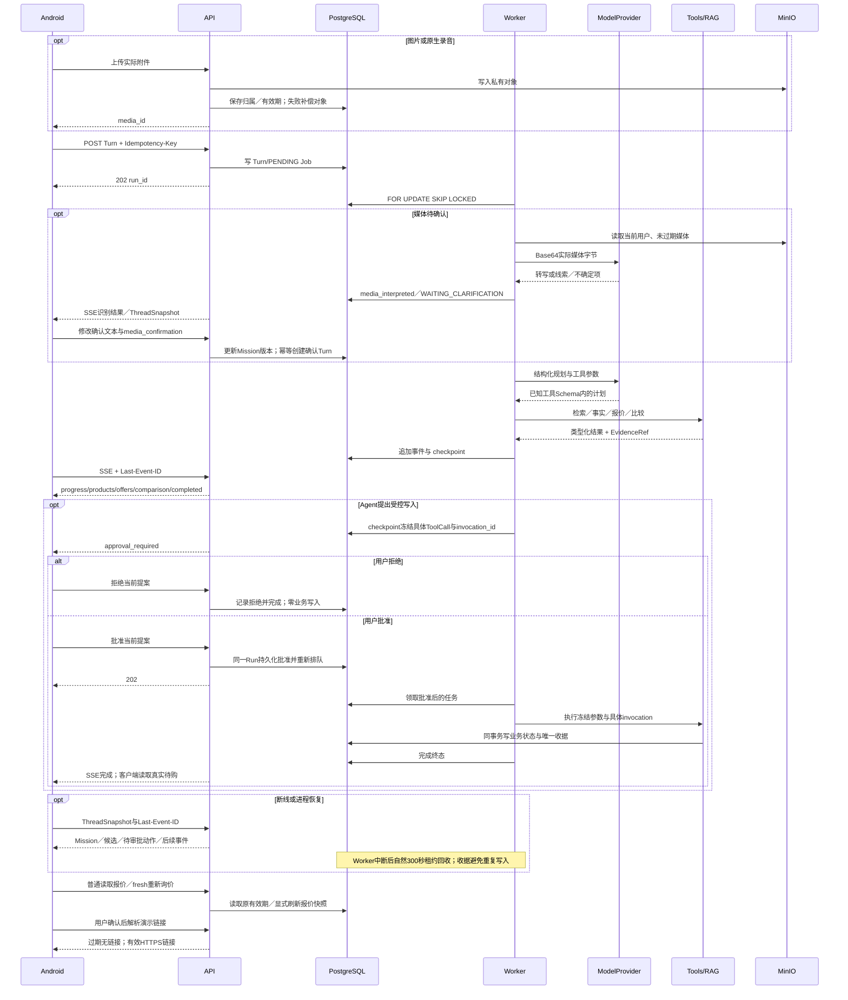

# V3 Agent 时序：媒体确认、冻结审批与恢复

2026-10-13当前源码；此图说明已实现流程，A02/M03真实人声仍待验收。

仅公开阶段与结构化结果。模型失败进入明确错误，不回退fake；普通报价读取不续期。原生保存/待购确认与Agent写入审批使用真实API状态，外跳仅演示安全边界。

当前真实批准和恢复分别见`final-real-A08-R5-20261013.json`、`final-real-A10-R5-20261013.json`；租约故障注入见`final-N07-worker-process-recovery-02-20261013.json`。媒体转写的人声效果不能由这张图代签。
