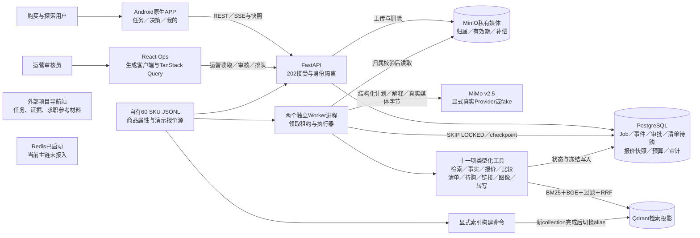

# V3 C4 容器图：当前本地候选

版本0.3.0／公共契约0.2.0；2026-10-13源码核对。沿用现有Mermaid格式，图中区分商品输入、运行状态与外部模型。

用户状态、任务、审批、报价快照和事件以PostgreSQL为权威；商品属性由冻结自有JSONL加载，不宣称已建设市场商品主数据平台。Qdrant查询进程只读，显式构建失败保留旧索引。Redis容器存在，但当前persistent_demo组合未注入共享限流或缓存适配器；导航站在产品运行链之外。

模型不直接写入业务状态。执行器控制Schema、用户归属、具体调用审批、幂等、48,000 Token单Run与共享2M预算。媒体只提供需求线索，报价始终为DEMO_FIXTURE。

代码：`apps/api/src/ragcommerce_api/persistent_demo.py`、`apps/worker/src/ragcommerce_worker/persistent_demo.py`、`apps/api/src/ragcommerce_api/postgres_demo.py`、`apps/api/src/ragcommerce_api/provider_config.py`、`scripts/build_retrieval_index.py`。当前运行证据见`docs/evidence/v3/final-N07-quality-20261013.json`。
